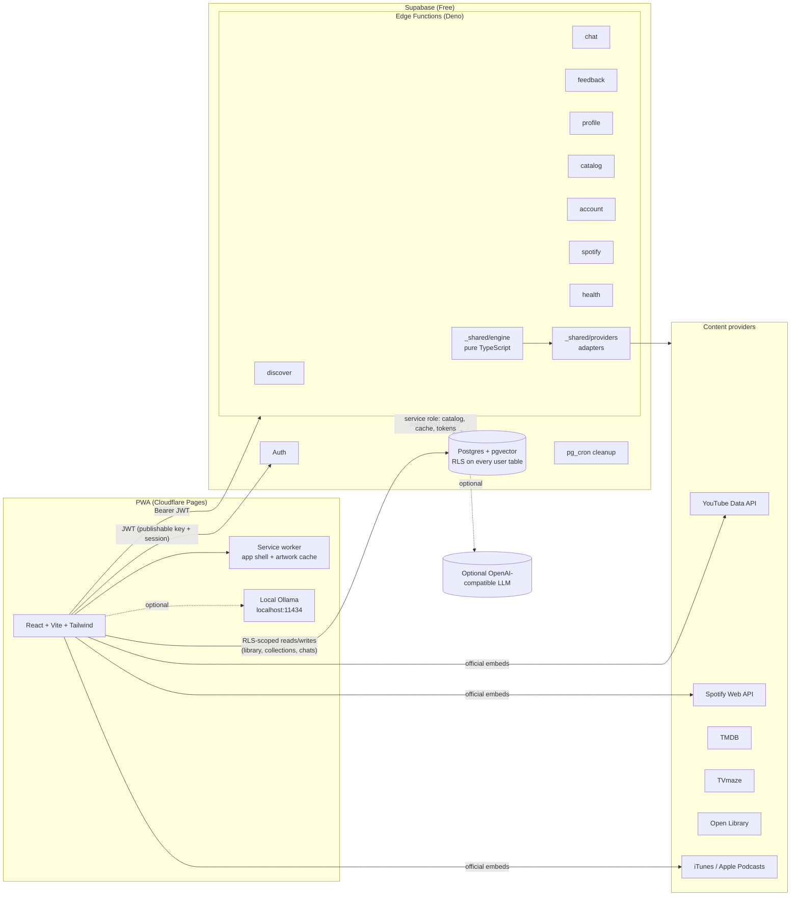

# ECHO architecture

## System overview



### Why this shape

| Decision | Rationale |
|---|---|
| **PWA on Cloudflare Pages** | One codebase for Windows/macOS/Android/iOS/tablets; free, unmetered static bandwidth; installable. |
| **Supabase (Postgres + Auth + Edge Functions)** | Free tier covers auth, a relational store with RLS, pgvector and serverless TypeScript in one place. Account data syncs across devices through the database. |
| **Engine as pure TypeScript in `supabase/functions/_shared/engine`** | The same code runs in Deno (production), Node/Vitest (tests) and is type-shared with the React app. No Python service to host. Every stage is a pure, testable function. |
| **Deterministic concept space first, AI second** | ECHO must work with zero paid inference. A curated lexicon of ~50 concepts (themes, moods, qualities) gives a transparent, explainable semantic layer shared by all media. Embeddings (Supabase's free built-in `gte-small`) and an optional LLM are additive. |
| **Ranking in Edge Functions, not the browser** | Provider keys stay server-side; caching and quota accounting are shared; collaborative filtering needs cross-user aggregates that must never reach a browser. |
| **Provider adapters behind one interface** | `Provider { search, resolve?, similar? }` normalised to one `ContentItem` schema. Swapping TMDB for another film source, or adding restaurants/events, means one new adapter plus a category entry. |
| **Keyless fallbacks** | Open Library, Apple Podcasts/iTunes and TVmaze make every category except YouTube usable before you create any developer account. |
| **Embeds only for playback** | YouTube IFrame Player (nocookie host), Spotify Embed, Apple Podcasts embed, publisher-provided audio and licensed previews. No stream extraction, ever. |

## Recommendation pipeline

`engine/pipeline.ts` orchestrates eight steps; each response includes timings and details per step (shown in the UI as "intent → retrieval → analysis → ranking").

1. **Intent** (`intent.ts`). A rules parser extracts categories, moods, themes, genres, exclusions ("no horror"), relaxations ("doesn't have to be sci‑fi"), references ("like Interstellar", quoted titles), ordinal references ("the second one"), emotional trajectory ("starts melancholic → becomes uplifting", "sunrise after a difficult night"), energy, complexity, exploration, duration, language, preference statements and search keywords. In a conversation, `refineIntent` merges follow-ups ("less dark", "only books"). An optional LLM or client Ollama hint is **sanitised** (`ai.ts`) to known ids and merged.
2. **Retrieval** (`retrieve.ts`). Plans a small, quota-aware set of provider queries per category: literal keywords (skipped for metaphorical mood requests), typed genres, trajectory endpoints, and concept-specific search terms. In feed mode, *familiar* picks the strongest profile concepts and *adventurous* walks the concept graph to adjacent-but-unexplored concepts. References are resolved to real catalog items; provider "similar" lists (TMDB recommendations) are added.
3. **Enrichment.** Provider metadata normalised to `ContentItem`; responses cached in `provider_cache` (TTL per provider); TMDB keywords for references.
4. **Semantic analysis** (`analyze.ts`). Title, genres, tags/subjects and description are projected into the concept space with saturating weights; genre hints map words like "blues" → melancholic. Items with too little metadata inherit the concept they were searched for at a weak 0.35. This is flagged as `inheritedConcepts` and **never used in explanations**. Optional `gte-small` embeddings (never for Spotify items).
5. **Personal ranking** (`rank.ts`), with e = exploration:

   ```
   familiar     = 0.55·deep + 0.45·surface
   adventurous  = 0.5·min(1, deep/0.5) + 0.5·novelty − 0.3·max(0, surface)
   personal     = (1−e)·familiar + e·adventurous
   total        = wq·query + wp·personal + wx·(1−0.6e)·context + wql·quality + wcf·collaborative + ws·semantic − penalties
   ```

   - `query`: cosine(intent target, item concepts) + keyword and genre hits + reference similarity.
   - `deep`: cosine(positive profile concepts, item) − ½·cosine(negative, item). This is the cross-media signal.
   - `surface`: genre/creator/category affinity (tanh-squashed).
   - `novelty`: 1 − familiarity of the item's genres/creators.
   - `context`: short-term mood vector.
   - Penalties: excluded/blocked concepts, disliked creators, duration/language/energy mismatch.
   - Weights shift when there is a query, and when the profile is cold.
6. **Diversity.** MMR with λ = 0.82 − 0.22e over a similarity of shared creator, concept cosine, shared genre and same category. Max two items per creator. When a trajectory is requested, picks are sequenced from the start mood to the end mood.
7. **Explanation.** Up to two reasons in priority order: reference → trajectory step → query match → profile/cross-media evidence ("You liked *Solaris* (book); this song carries the same cosmic and psychological qualities") → creator → novelty → collaborative → provider rating. Every clause is derived from item metadata, the parsed request or recorded feedback. The full breakdown (reasons, detected concepts, score components) is exposed under "Why this?".
8. **Feedback** (`profile.ts`). Signals: like +1, save +0.7, finished +0.5, play +0.15, open +0.1, skip −0.2, unsave −0.3, dislike −1, rating (r−3)/2. A soft-bounded update moves concept, per-category concept, genre, creator and category weights. Dislikes move concepts half as much as creators. The learning rate decays with experience (0.45 → 0.12). Long-term weights decay with a ~120-day half-life and the short-term mood with ~8 h. Weekly snapshots power "emerging interests".

### Long-term vs temporary preferences
- **Long-term:** `concepts`, `conceptsByCategory`, `genres`, `creators`, `categories`, `explicit` (statements, pins, blocks).
- **Temporary:** `shortTerm.concepts`, fed by moods expressed in chat and recent positive feedback, decaying within hours. It is used only as the `context` signal.

## Data model (Postgres)

| Table | Purpose | Access |
|---|---|---|
| `profiles` | display name, onboarding, settings | own row (RLS) |
| `taste_profiles` | learned model (JSONB) + profile embedding | own row |
| `taste_snapshots` | weekly concept snapshots | own rows (read/delete) |
| `content_items` | normalised shared catalog cache + concepts + embedding | read: signed-in; write: service role |
| `interactions` | append-only feedback log | own rows (insert/read/delete) |
| `library_items` | saved/liked/rated/finished state | own rows |
| `collections`, `collection_items` | user collections | own rows (ownership checked on insert) |
| `chat_sessions`, `chat_messages` | conversations + last intent for refinement | own rows |
| `recommendation_events` | what was shown, with scores (history, evaluation) | own rows |
| `oauth_tokens`, `oauth_states` | Spotify tokens, PKCE state | **server only** |
| `provider_cache`, `provider_status`, `rate_limits` | caching, quota circuit breaker, rate limiting | **server only** |

Functions: `handle_new_user` (signup trigger), `check_rate_limit` (server-only), `cf_scores` (aggregate item-item CF with community threshold and k ≥ 2), `echo_cleanup` (pg_cron daily).

## Edge Functions

| Function | Method | Purpose | Rate limit |
|---|---|---|---|
| `discover` | POST | feed / one-shot query | 30/min |
| `chat` | POST | conversational discovery with memory | 20/min |
| `feedback` | POST | learn from an interaction, update library | 120/min |
| `profile` | GET/POST | model + insights; edit / onboarding / reset | 30/min (POST) |
| `catalog` | POST | lookup (onboarding), TMDB trailer, YouTube refresh | 40/min |
| `account` | POST | export / delete | 5/min |
| `spotify` | GET/POST | OAuth PKCE callback, status, disconnect, create playlist | 20/min |
| `health` | GET | public capability report (no secrets) | — |

## Scaling path (when ECHO becomes multi-user)

- **Catalog:** `content_items` is already shared and deduplicated, so popular items are fetched once for everyone. Add an HNSW index on `embedding` and move candidate generation partly to pgvector ANN search over the stored catalog.
- **Collaborative filtering:** `cf_scores` switches on automatically at `ECHO_CF_MIN_USERS`. Beyond that, precompute item-item co-occurrence in a materialised view refreshed by pg_cron, or train implicit-feedback MF offline.
- **Evaluation:** `recommendation_events` + `interactions` provide impressions and outcomes for offline metrics (CTR@k, save rate, novelty, intra-list diversity) and A/B tests. Add a `variant` column to events.
- **Providers:** new categories (restaurants, destinations, events, courses) need a `Category` entry, an adapter and concept search terms. The engine is category-agnostic.
- **Premium features:** server-side LLM explanations, larger embedding models, more YouTube quota, family/shared profiles. All fit behind existing function boundaries.
- **i18n:** the concept lexicon is language-specific; add per-language term lists and use `language` already present on items and intents.
